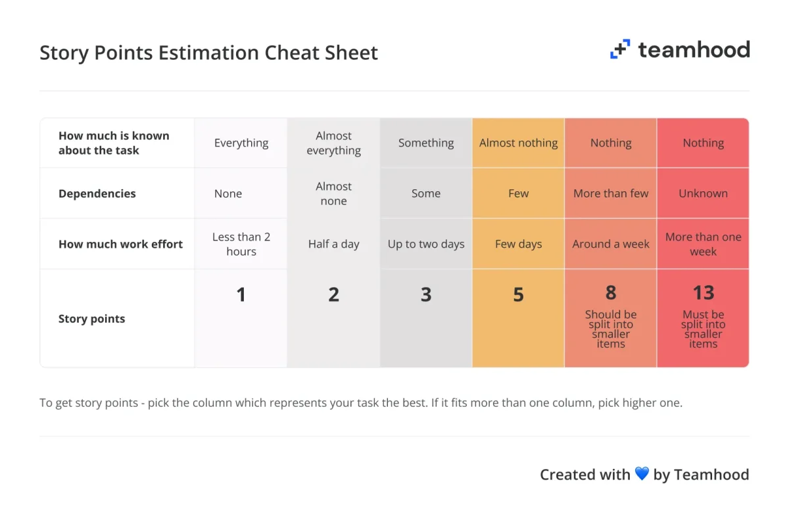

# How we track the work

Mesh Barista is planned in 2-week sprints on GitHub and tracked with the
[UIW-PMD dashboard](https://github.com/UIWCyber/UIW-PMD). The dashboard is read-only: everything it
shows comes from the issues, milestones and project board here, so **the issues are the plan**. Follow
the conventions below and the Gantt, board, burndown and workload charts stay correct.

- **Board:** the "Mesh Barista" GitHub Project, linked to this repo (Projects tab).
- **Sprint 1 starts:** Mon Nov 16, 2026. Sprint 2: Nov 30 to Dec 13.
- **Team:** Sebastian Cadena, Daniel Critchlow Jr.

## How the work is broken down

The dashboard shows one hierarchy: **Milestone → User Stories → Tasks / Issues → Sub-tasks / Bugs**.

| Level | What it is here | Example |
| --- | --- | --- |
| Milestone | A deliverable with a due date. The due date puts its work in a sprint. | *Reliable hardware*, due Nov 29 |
| User Story | Something a user needs, with acceptance criteria. | *User Story - Every pour is based on a measured flow rate* |
| Task / Issue | One piece of work toward a story, a day or two at most. | *Task: Measure each pump's flow rate* |
| Sub-task / Bug | A small step inside a task, or a defect. | *Bug: A relayed mesh message can be processed twice* |

Current milestones:

| Milestone | Due | Sprint | Goal |
| --- | --- | --- | --- |
| Reliable hardware | Nov 29 | 1 | Node 1 survives the cream pump, sensors stop drifting, the order queue works on real hardware, firmware weak spots fixed |
| Measured accuracy | Dec 6 | 2 | Measured flow rates and pour error, ruler-calibrated sensors, docs match the hardware |
| Next-version design | Dec 13 | 2 | Dr. Okan's feedback: accuracy across liquids, materials and pumps, load cell plan, accessory direction |

## Rules for every issue

These are the UIW-PMD conventions. The issue templates (**New issue** → pick a type) fill them in.

1. **Say what type it is.** Start the title with `User Story - `, `Task: `, `Issue - `, `Bug: ` or
   `Sub-task: `, and add the matching label (`user story`, `task`, `issue`, `bug`, `sub-task`). An item
   with no type shows as **Untracked** and sorts last.
2. **Put it in a milestone.** Without one it lands under **No milestone** at the bottom of the timeline.
3. **Link it to its parent.** Add tasks as **sub-issues** of their story (issue sidebar → *Create
   sub-issue* or *Add existing issue*), and also write `Parent: #7` in the task's description. Parent and
   child must be in the same milestone. A task that is not linked shows under **Not linked to a story**.
4. **Estimate it in story points.** Pick the number with the [story points guide](#story-points-guide)
   below, write `Story points: 3` under *Estimation of effort* in the description, and set the same
   number in the board's **Story Points** field. Unestimated items show **–**.
   - Estimate **tasks, issues, bugs and sub-tasks** with the guide. A **story's** points are the sum of
     its tasks: the dashboard counts a story's estimate once, covering its tasks, so it does not add
     them again. Keep the two equal when a task is added, removed or re-estimated.
   - A task at **8** should be split and a task at **13** must be split. A story whose tasks add up to
     8 or more is too big for one sprint: split it into two stories.
5. **Mark blockers.** Write `Blocked by #12` (or `Depends on #12`) in the description.
6. **Put it on the board.** In the issue sidebar, **Projects → Mesh Barista**, then set its **Status**,
   **Story Points** and **Sprint**.

## Story points guide

Pick the column that describes the item best on all three rows. **If it fits more than one column, pick
the higher one.** The work effort row is for one person working on it.

| Story points | 1 | 2 | 3 | 5 | 8 | 13 |
| --- | --- | --- | --- | --- | --- | --- |
| **How much is known about the task** | Everything | Almost everything | Something | Almost nothing | Nothing | Nothing |
| **Dependencies** | None | Almost none | Some | Few | More than few | Unknown |
| **Work effort** | Less than 2 hours | Half a day | Up to two days | A few days | Around a week | More than a week |
| **Action** | | | | | Should be split into smaller items | Must be split into smaller items |

Examples from this project:

| Item | Points | Why |
| --- | --- | --- |
| Task: Listen to every sound once | 1 | Everything known, no dependencies, under 2 hours |
| Task: Measure each pump's flow rate | 2 | Method known, about half a day with three pumps |
| Task: Power each water sensor from a GPIO, on only while reading | 3 | Wiring and firmware on two nodes, up to two days |
| Task: Prototype a load cell reading under the cup | 3 | New part, but one board and one sensor |

Only **1, 2, 3, 5, 8, 13** are valid for tasks, issues, bugs and sub-tasks. A story's total can be any
number, because it is a sum.

Guide adapted from the *Story Points Estimation Cheat Sheet* by Teamhood. The table above is the text
version that agents and tools should read; the image is the original.

## Board columns

| Status | Means | Who moves it |
| --- | --- | --- |
| Backlog | Not planned into a sprint yet | Sprint planning |
| Ready | Meets the Definition of Ready, planned for this sprint | Sprint planning |
| In Progress | Someone is working on it: assign yourself when you move it here | Whoever picks it up |
| In Review | A pull request is open, or a measurement is waiting for a teammate to check | The person who did the work |
| Done | Meets the Definition of Done, issue closed | Closing the issue or merging its PR (automatic) |

Keep work in progress small: one or two cards **In Progress** per person.

### Definition of Ready

A story can move to **Ready** when it has a **milestone**, an **assignee**, **acceptance criteria**, an
**estimate**, and its tasks are created as sub-issues. Clear any `Blocked by` first.

### Definition of Done

- Every acceptance criterion is checked off.
- Code changes are merged into `main` through a pull request that says `Closes #N`.
- Firmware changes are flashed and checked on the real nodes (see `HANDOFF.md`, "How to work on the
  hardware"); say which nodes in the PR.
- Measurements are recorded in a comment on the issue (raw numbers, not just the result).
- `README.md`, `WIRING.md` or `HANDOFF.md` are updated if the change affects them.

## The sprint

| When | What | Time |
| --- | --- | --- |
| First Monday | **Sprint planning:** pick stories from Backlog for the sprint goal, check each meets the Definition of Ready, set assignees, move to **Ready** | 30 min |
| Every class day or by message | **Stand-up:** what I did, what I'll do, what blocks me. Open the dashboard's **Activity → Recent activity** (24 hours) first | 10 min |
| Last Friday | **Sprint review:** demo what is Done on the hardware; unfinished work goes back to Backlog or the next sprint | 20 min |
| Last Friday | **Retrospective:** what to keep, what to change; add one improvement as an issue | 15 min |

## Branches and pull requests

- Branch from `main` for every task: `task/42-flow-rate`, `bug/45-mesh-duplicates`.
- Mention the issue in commits (`Measure pump flow rates (#42)`) so the work shows on the issue.
- Open a pull request that says `Closes #42`; the other teammate reviews it. Merging closes the issue and
  moves the card to Done.
- Never commit Wi-Fi passwords (`MESH_SSID` / `MESH_PASSWORD` stay placeholders).

## Tracking it on the UIW-PMD dashboard

1. Open `git_project-dashboard.html` from [UIW-PMD](https://github.com/UIWCyber/UIW-PMD) in a browser.
2. **••• → Connect a project…** and fill in:
   - **Project link:** `https://github.com/bash-y/mesh-barista`
   - **Sprint 1 starts on:** `2026-11-16`
   - **Access token:** to read the board's **Story Points** field and **Status** column, use a classic
     token with **repo** and **read:project** (the board belongs to a user, not an organization). A
     fine-grained token with Contents, Issues and Pull requests set to read-only works too, but then the
     dashboard shows only open or closed for status and reads points from the `Story points:` line in
     each issue.
3. Use it like the PMD README says:
   - **Daily:** Recent activity and the Board.
   - **Each sprint:** Burndown against the ideal line; Velocity compared with the last sprint.
   - **Each milestone:** the Gantt at the *User Stories* outline level; look for blocked and unlinked items.
   - **Team health:** Workload by member, so the work is split fairly. This needs every item assigned.
